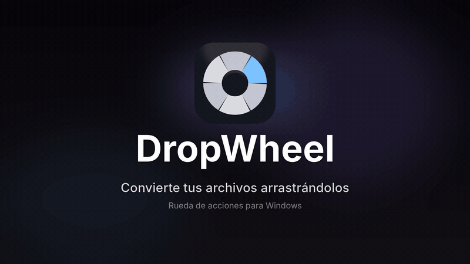
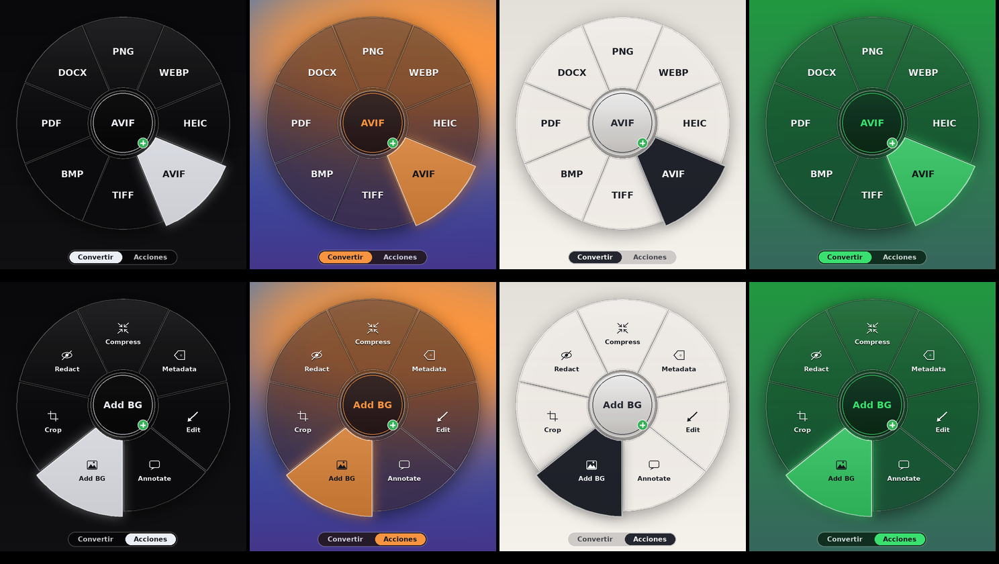

<p align="center"></p>

<h1 align="center">DropWheel</h1>
<p align="center"><b>Mantén Shift, arrastra un archivo y suéltalo sobre un formato.</b><br>
Rueda de conversión y acciones para Windows · vidrio esmerilado que toma el color de tu fondo · siempre crea una copia.</p>
<p align="center"><a href="docs/demo.mp4">Ver el video completo</a> · <a href="../../releases/latest">Descargar instalador</a> · Licencia MIT</p>

<p align="center"></p>

La rueda de conversión del video, para Windows: **mantén Shift, arrastra un archivo y suéltalo sobre la
opción que quieras**. Siempre se crea una **copia** junto al original; el original no se toca.

## Instalación

Doble clic a **`DropWheel-Setup.exe`** y listo. Trae su propio Python y todas las librerías, no necesitas instalar
nada más ni tener permisos de administrador. Crea el acceso directo en el escritorio y en el menú Inicio, y al
terminar te deja abrirlo y, si quieres, que se inicie con Windows. Para quitarlo: *Configuración → Aplicaciones →
DropWheel → Desinstalar* (o el acceso "Desinstalar DropWheel" del menú Inicio).

Como el instalador no está firmado digitalmente, Windows SmartScreen puede mostrar "Windows protegió su PC":
elige **Más información → Ejecutar de todas formas**. (Firmarlo requiere un certificado de pago.)

Quedó un icono en la bandeja del sistema (junto al reloj). Desde ahí puedes activar/desactivar la rueda, el inicio
con Windows, el tamaño, y abrir la configuración.

## Cómo se usa

- Empieza a arrastrar un archivo en el **Escritorio** o en el **Explorador** y **mantén Shift** (puedes
  presionarlo antes o durante el arrastre). La rueda aparece alrededor del cursor.
- Suelta sobre un formato (PNG, JPG, WEBP, HEIC, AVIF, TIFF, BMP, PDF, DOCX, TXT) y se crea la copia.
- La rueda tiene dos páginas, **Convertir** y **Acciones**. Para cambiar de página: presiona **Tab** o
  **Espacio** durante el arrastre, o deja el cursor un instante sobre el **centro**.
- Acciones (imágenes): Compress, Metadata, Edit, Annotate, Add BG, Crop, Redact. Compress y Metadata
  también sirven para PDF. Cada una abre una ventanita, y al guardar crea una copia con sufijo
  (`Cropped`, `Compressed`, `Redacted`…).
- Para cancelar, suelta fuera de la rueda o presiona Esc.

| Archivo | Convertir a |
|---|---|
| Imagen (PNG, JPG, WEBP, BMP, TIFF, HEIC, AVIF, GIF) | las otras imágenes, PDF, DOCX |
| PDF | JPG, PNG, TXT, DOCX (una imagen por página si tiene varias) |
| DOCX | PDF, TXT |
| TXT | PDF, DOCX |

Si sueltas varios archivos del mismo tipo, se convierten todos.

## Colores y estilo

La rueda y las ventanas **toman el color del fondo**: al arrastrar, DropWheel captura lo que hay detrás de la
rueda, lo desenfoca (vidrio esmerilado) y lo tiñe con el color dominante. Con un fondo casi negro queda vidrio
oscuro; con uno azul o verde toma ese tono; con uno claro, vidrio claro. El segmento activo usa el color más vivo
del fondo (o un blanco suave si el fondo es monocromo). Se puede ajustar en la configuración:
`style` ("auto", "dark", "light"), `accent` ("auto", "system" = color de énfasis de Windows, o "#RRGGBB"),
`glass` (false = color liso sin captura de pantalla) y `animations` (fundido de entrada).

## Consumo de recursos

El proceso residente solo revisa el mouse y Shift 25 veces por segundo (sin hooks globales, así no lo
marcan los antivirus como keylogger), no abre nada hasta que arrastras algo y devuelve la RAM al sistema
cada vez que cierra la rueda. Conversiones y ventanas de edición corren en procesos aparte que se cierran
al terminar. Si te parece más, usa **Tamaño de la rueda → Compacta** desde el icono.

## Configuración

Icono de bandeja → *Abrir configuración…* (`%APPDATA%\DropWheel\settings.json`), luego *Recargar*.
Opciones: `style`, `accent`, `glass`, `animations`, `trigger` ("shift", "ctrl" o "alt"), `size`, `any_window` (activar sobre cualquier programa),
`extra_window_classes` (otros exploradores de archivos), `require_drag_image`, `reveal_in_explorer`, `notify`.

## Si algo no funciona

- Mira `log.txt` en `%APPDATA%\DropWheel`.
- **La rueda no aparece al arrastrar con Shift:** pon `"require_drag_image": false` en la configuración.
- **DOCX → PDF:** usa Microsoft Word o LibreOffice si están instalados (conserva el formato). Sin ellos, genera un PDF
  solo con texto y títulos.
- **PDF → DOCX:** conserva bastante diseño con `pdf2docx`; los PDF escaneados (imágenes) no se convierten a texto.

## Reconstruir el instalador (opcional, desarrolladores)

`installer/build.sh` arma el Python de Windows (conda-forge), instala las librerías y compila el instalador con NSIS desde Linux.

## Estructura

`dropwheel/agent.py` proceso residente · `wheelgfx.py` dibujo de la rueda · `droptarget.py` recibir archivos
arrastrados · `engine/` conversiones y acciones · `ui/` ventanas · `worker.py` proceso que hace el trabajo ·
`tests/` pruebas.


## Privacidad y seguridad

- **Sin red:** DropWheel no se conecta a internet ni envía nada. Todo se procesa en tu PC.
- **Sin keylogger:** no usa hooks globales de teclado; solo consulta el estado de Shift y del botón del mouse
  mientras arrastras. No lee ni guarda lo que escribes.
- **Captura de pantalla limitada:** solo toma la zona que queda detrás de la rueda, para el efecto de vidrio, y la
  descarta al instante (se puede apagar con `glass: false`).
- **No toca tus originales:** siempre escribe copias nuevas con nombre único.
- El instalador no está firmado, así que SmartScreen puede advertir. Puedes revisar todo el código aquí y
  construirlo tú mismo con `installer/build.sh`.
- Estado: **beta**. Probado con pruebas automáticas y en un entorno Wine; reporta problemas en *Issues*.

## Pruebas

```
python -m unittest discover tests
```
